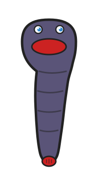

# leech2

<p align="center">
  
</p>

leech2 tracks changes to tables. It computes deltas between table snapshots,
stores them as linked blocks, and can produce consolidated patches that convert
into SQL statements for replaying changes on a target database.

leech2 ships as both a Rust library with a C-compatible FFI and a CLI tool.

## Installing

```sh
# On macOS
brew install larsewi/tap/leech2
```

On Linux and Windows, grab a package from the
[releases](https://github.com/larsewi/leech2/releases): a `.deb` or `.rpm` for
Linux, an `.msi` for Windows. Nothing below is needed to install a package; the
build dependencies only matter if you build from source.

## Upgrading

When upgrading, upgrade the [hub](TERMINOLOGY.md#hub) before its
[agents](TERMINOLOGY.md#agent). A hub reads patches from older agents, but an
older hub may not read patches from newer agents.

## Build dependencies

```
# On macOS
brew install protobuf

# On Linux
sudo apt install protobuf-compiler

# On Windows
choco install protoc
```

## Building

```sh
cargo build  # build the library and CLI
cargo test   # run all tests
```

## Quick start

```sh
# Initialize a work directory with an example table
lch init

# Create a block to record the changes
lch block create

# Generate a patch
lch patch create

# Convert the patch to SQL
lch patch sql

# Mark the patch as applied so next patch starts from here
lch patch applied

# If applying the patch fails, force full state on next patch
lch patch failed
```

Pass `--dry-run` to any command to compute the changes and print what it `Would
have ...` done without changing anything on the disk.

## Configuration

See [CONFIGURE.md](CONFIGURE.md) for the configuration reference.

```toml
[tables.products]
fields = [
    { name = "id",    type = "NUMBER", primary-key = true },
    { name = "name",  type = "TEXT" },
    { name = "price", type = "NUMBER" },
]

[tables.products.csv]
source = "products.csv"
header = true
```

## Injected fields

Injected fields add an extra field to each table. They are useful when multiple
agents report to the same hub. They let the hub tell where the data came from,
and prevent one agent from touching another agent's data.

The hub passes them to `lch_patch_to_sql()` or `lch patch sql --inject`.

```sh
lch patch sql --inject hostkey abc123 TEXT --inject count 42 NUMBER
```

## C API

See [`include/leech2.h`](include/leech2.h) for the full API reference.

The `.deb` and `.rpm` packages and the Homebrew formula install a `leech2.pc`
file, so consumers can discover compile and link flags with
`pkg-config --cflags --libs leech2`.

```c
lch_config_t *cfg = lch_init("/path/to/workdir");

lch_block_create(cfg, NULL);

lch_buffer_t patch = {0};
lch_patch_create(cfg, NULL, &patch);

char *sql;
lch_patch_to_sql(cfg, &patch, NULL, 0, &sql);
printf("%s", sql);
lch_string_free(sql);

if (hub_send(patch.data, patch.len)) {
  lch_patch_applied(cfg, &patch);
} else {
  lch_patch_failed(cfg);
}
lch_buffer_free(&patch);

lch_deinit(cfg);
```

## Logging

**CLI:** Logs are written to stderr. Set the `LEECH2_LOG` environment variable
to control the log level (e.g. `LEECH2_LOG=debug`).

**FFI:** Call `lch_log_init()` first to receive log messages through a callback.
See [`include/leech2.h`](include/leech2.h) for the full API. Available levels:
`LCH_LOG_ERROR` (1), `LCH_LOG_WARN` (2), `LCH_LOG_INFO` (3), `LCH_LOG_DEBUG`
(4), `LCH_LOG_TRACE` (5). Trace messages are only emitted in debug builds;
release builds strip them at compile time.

## Man pages

Man pages are included in the `.deb` and `.rpm` packages and the Homebrew
formula, and under `man/` in the source tarball and the Linux and macOS
tarballs. After installing a package, run `man 1 lch` or `man 3 leech2.h` to see
them.

## Contributing

See [CONTRIBUTING.md](CONTRIBUTING.md) for architecture details, data flow, and
development guidelines.
